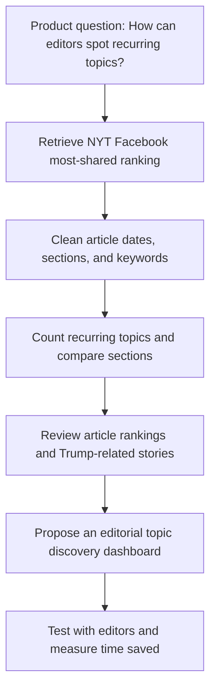

# Editorial Topic Discovery — A Product Management Case Study

**An independent analysis of New York Times articles appearing in the Facebook most-shared ranking during the 2026 U.S. midterm election week.**

**Tools:** Python · Pandas · Jupyter Notebook · NYT Most Popular API · Matplotlib  
**Project stage:** Exploratory analysis and proposed product concept; not a deployed or validated product.

## 1. The problem

Editors have many stories to review. I wanted to explore a simple question:

> Could a dashboard showing repeated topics in popular article rankings help editors find stories to review faster?

This is a **product hypothesis**, not a confirmed problem reported by NYT editors.

## 2. What I did

1. Used the NYT Most Popular API to retrieve a ranked list of **20 articles** for the 30-day Facebook most-shared endpoint.
2. Organized article titles, sections, dates, keywords, and ranking positions in Python.
3. Counted how many listed articles contained each topic tag.
4. Compared sections and inspected articles about Donald Trump.
5. Proposed a simple editorial discovery tool and a plan to test whether it would be useful.

## 3. Results from my saved notebook

| Finding | Result | What it means |
|---|---:|---|
| Articles in the API response | **20** | This is a ranked sample, not every NYT article. |
| Tagged `Midterm Elections (2026)` | **15 of 20 (75%)** | Midterm-election content appeared frequently in this sample. |
| Tagged `Elections, Senate` | **13 of 20 (65%)** | Senate-election topics were also common. |
| Articles in the `U.S.` section | **17 of 20 (85%)** | U.S. stories dominated this particular list. |
| Trump-related articles | **4 of 20 (20%)** | Four matched a Trump keyword or title search within the sample. |
| Articles published within the preceding 14 days | **20 of 20** | All retrieved articles were recently published; this is **not** a 14-day sharing trend. |

**Context:** The snapshot was captured during U.S. midterm election week. This is an event-specific sample, so it does not show typical topic patterns throughout the year.

### What I learned

- **Topic tags can reveal repeated themes.** The midterm-election tag appeared on 15 articles in the ranked sample.
- **The ranked sample was concentrated in one section.** The U.S. section contributed 17 articles, while Arts, New York, and Opinion contributed one each.
- **A topic count is not an engagement metric.** The API did not give me the number of Facebook shares, clicks, or referrals.

These findings prompted a product question: **Would editors benefit from a quick way to inspect the stories behind recurring topics?**

## 4. Product idea: Editorial Topic Discovery Dashboard

**Potential users:** Social editors, audience development teams, and editorial staff.  
**Product hypothesis:** A single view of recurring topics and their related articles could reduce time spent manually reviewing popular-content lists.

### Proposed MVP

| Priority | Feature | Why it matters |
|---|---|---|
| P0 | Topic leaderboard | Quickly see which tags appear most often. |
| P0 | Section filter | Narrow the view to a relevant editorial section. |
| P0 | Article detail links | Inspect the stories behind each topic. |
| P1 | Saved daily snapshots | Track how rankings and topic appearances change over time. |
| P2 | Topic alerts | Notify editors when a topic repeatedly appears, if users request it. |

**Example user story:** As a social editor, I want to select a topic and see its related ranked articles so that I can decide which stories need a closer look.

## 5. How I would test the product

1. **Interview 3–5 editorial or social media professionals** to learn how they currently discover stories.
2. **Build a basic clickable prototype** with a topic leaderboard, section filter, and article links.
3. **Run a usability test:** ask users to find three relevant stories using their normal method and then the prototype.
4. **Measure:** task completion time, task success, perceived usefulness, and repeat usage in a pilot.
5. **Decide:** improve, expand, or stop the concept based on feedback.

No user research, usability results, or product impact is claimed yet.

## 6. Data limitations

- The API response is a **top-ranked list**, not all NYT articles published in 30 days.
- Topic frequency counts **articles with tags**, not Facebook shares or audience preference.
- The API does not expose share counts, impressions, clicks, or referral traffic.
- Filtering articles by their publication date does **not** reconstruct 14-day sharing activity.
- A single snapshot does not show a historical trend; daily snapshots would need to be collected going forward.
- Tags can overlap: one article may contribute to several topic counts.
- Internal metadata tags (for example, `internal-disable-fab`) should be excluded from reader-facing topic charts.
- Results may change if the API is requested again at a later time.

## 7. How to run the notebook

1. Install Python 3 and Jupyter.
2. Install dependencies: `pip install pandas requests matplotlib python-dotenv ipykernel`.
3. Obtain a NYT developer API key with access to the Most Popular API.
4. Create a local `.env` file containing `NYT_API_KEY=your_key_here` and **do not commit it**.
5. Open the notebook in Jupyter or VS Code and run the cells in order.

**Reproducibility note:** The current notebook imports a local `NYTimes_main.py` module. Before sharing publicly, replace that dependency with a documented API request, or include a safe, key-free module. The numerical findings above describe the **saved notebook outputs**, not necessarily results of a new request.

## 8. What I would do next

- Remove duplicate notebook cells and internal metadata from charts.
- Save a dated, reproducible snapshot of the ranking if permitted by the data source's terms.
- Prototype the dashboard and validate the workflow with real users.
- Add more daily observations before making claims about trends over time.

---

*Independent educational portfolio project. Not affiliated with or endorsed by The New York Times. All product recommendations are proposals, not NYT product decisions.*
